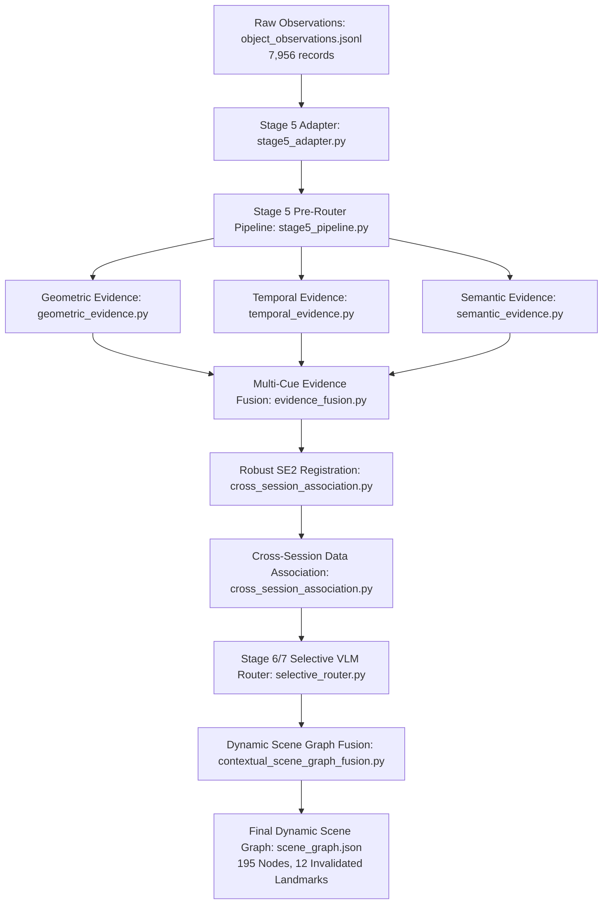

# Pipeline and Data Flow Architecture

This document traces the exact end-to-end data flow from raw sensory observations to the final dynamic 3D scene graph, naming specific source modules, entry-point functions, data schemas, and mathematical transformations.

---

## 1. High-Level Pipeline Sequence

---

## 2. Stage-by-Stage Trace

### Stage 1: Raw Observation Ingestion & Normalization
- **Primary Source File:** `vlm/assignment/source_snapshot/src/stage5_adapter.py`
- **Key Function:** `adapt_observations_to_stage5(observations_path: Path) -> List[Dict[str, Any]]`
- **Input Data:** `data/observations/object_observations.jsonl` (7,956 JSON records).
- **Transformation:**
  - Extracts 3D camera-frame bounding box coordinates `[x_min, y_min, z_min, x_max, y_max, z_max]`.
  - Transforms coordinates into the RTAB-Map odometry/world reference frame using the recorded camera pose matrix $T_{world \leftarrow cam}$.
  - Computes bounding centroid $c = \frac{1}{2}(p_{min} + p_{max})$ and spatial extents $e = p_{max} - p_{min}$.
  - Normalizes tracking timestamps and associates observation IDs to causal track identifiers (`local_track_id`).

### Stage 2: Inexpensive Pre-Router Evidence Extraction
- **Primary Source File:** `vlm/assignment/source_snapshot/src/stage5_pipeline.py`
- **Key Function:** `run_stage5_pipeline(obs_jsonl_path, output_dir)`
- **Sub-Modules Executed:**
  1. **Geometric Evidence:** `geometric_evidence.py` -> `compute_geometric_evidence()`
     - Computes bounding box stability, aspect ratio variation, and depth point validity (100.0% valid).
     - Calculates 2D-to-3D projection consistency (mean reprojection distance: 5.43 px).
  2. **Temporal Evidence:** `temporal_evidence.py` -> `compute_temporal_evidence()`
     - Tracks lifespan, frame span, and occlusion gap events across 1,385 unique tracks.
     - Detects multi-track entity re-observations (79.2% rate) and track fragmentation (72.78% of tracks span <=4 frames).
  3. **Semantic Evidence:** `semantic_evidence.py` -> `compute_semantic_evidence()`
     - Projects detector classification onto a 3-class taxonomy: `IMMOVABLE`, `MOVABLE`, `MOBILE`.
     - Zero-shot CLIP feature verification and entropy scoring.
  4. **Multi-Cue Fusion:** `evidence_fusion.py` -> `fuse_evidence_records()`
     - Computes fused confidence $C_{fused} = w_g C_g + w_t C_t + w_s C_s$.
- **Output Artifacts:** `metrics/raw/stage5_evidence_metrics.json`.

### Stage 3: Robust SE(2) Inter-Session Alignment
- **Primary Source File:** `vlm/assignment/source_snapshot/src/cross_session_association.py`
- **Key Functions:**
  - `compute_robust_se2(s1_anchors, s2_anchors, inlier_threshold=0.20)`
  - `evaluate_registration_stability(anchor_pairs)`
- **Mathematical Formulation:**
  - Solves for 2D rigid transform $(R, t) \in \text{SE}(2)$ minimizing planar horizontal alignment error on the floor plane $(x, y)$:
    $$\min_{R \in \text{SO}(2), t \in \mathbb{R}^2} \sum_{i \in \mathcal{I}} \| R p_{1,i} + t - p_{2,i} \|^2$$
  - Uses RANSAC consensus with SVD Procrustes refitting on stationary architectural anchors (desks and storage boxes).
- **Result:**
  - Estimated Rotation: $\theta = -15.558^\circ$, Translation: $t = [-0.1059, 0.0486]^\top$ m.
  - Inliers: 7 consensus anchors with $\text{RMS} = 0.1198$ m.
  - Outliers: 3 peripheral anchors ($e = 0.3897$ m to $0.6180$ m) rejected due to boundary SLAM drift.
- **Output Artifact:** `benchmarks/registration/stage5_registration_audit.json`.

### Stage 4: Cross-Session Data Association & Baselines
- **Primary Source File:** `vlm/assignment/source_snapshot/src/cross_session_association.py`
- **Key Functions:**
  - `associate_cross_session_candidates()`
  - `evaluate_cross_session_association()`
- **Evaluated Algorithms:**
  1. `BASELINE_1_NEAREST_CENTROID`: Greedy nearest-neighbor centroid association under transformed coordinates.
  2. `BASELINE_2_HUNGARIAN_GATED`: Global optimal bipartite matching with Euclidean gating threshold (0.45 m).
  3. `PROPOSED_UNCERTAINTY_SYMMETRIC`: Bipartite matching with Mahalanobis-like spatial uncertainty and symmetric ambiguity rejection.
  4. `PROPOSED_RELOCATION_AWARE`: Two-stage candidate association checking static spatial gates first, followed by semantic/extent matching for potential relocated objects.
- **Evaluation Contract:**
  - Ground truth benchmark: `benchmarks/ground_truth/cross_session_identity_annotations.json` (113 tracks across 52 instances, 30 multi-session ground truth instances).
  - Evaluates candidate precision, pair-level recall, physical-instance recall (deduplicating multiple tracks per instance), and false merge/split rates.
- **Output Artifacts:**
  - `metrics/derived/association_baselines_summary.json`
  - `metrics/derived/per_instance_association_diagnostics.json`.

### Stage 5: Stage 6/7 Selective VLM Routing
- **Primary Source Files:** `vlm/assignment/source_snapshot/src/selective_router.py`, `router_policy.py`
- **Key Function:** `SelectiveVlmRouter.route_instance(entity, candidate_crop_paths)`
- **Decision Logic:**
  - **Fast Rule Filter:** Checks if the entity has an architectural semantic prior (e.g., door, ceiling fan) or confirmed stationary geometry. If confidence exceeds threshold $\tau_{cheap}$, resolves as `IMMOVABLE` without calling the VLM (cost = 0 queries).
  - **VLM Escalation:** If evidence is ambiguous, low-confidence, or indicates possible relocation/affordance changes, invokes the multi-view VLM engine using harvested crops from `data/multiview_samples/`.
  - **Reproducibility Guarantee:** In offline evaluation, queries query the verified cache `metrics/raw/router_vlm_cache.json` (100% valid response rate, 0% hallucinated latency).
- **Output Artifact:** `metrics/raw/router_ablation_results.json`.

### Stage 6: Contextual Scene Graph Fusion & Landmark Invalidation
- **Primary Source File:** `vlm/assignment/source_snapshot/src/contextual_scene_graph_fusion.py`
- **Key Class & Method:** `ContextualSceneGraphFusionEngine.fuse_scene_graph(s1_tracks, s2_tracks, associations)`
- **Fusion Operations:**
  1. **Stationary Entity Merging:** Associated pairs with displacement below motion threshold ($< 0.30$ m) are merged into unified global entities with updated Kalman centroids.
  2. **Relocation Identification:** Entities associated across sessions whose displacement exceeds threshold ($\ge 0.30$ m) are flagged as `RELOCATED`. Pre-relocation and post-relocation coordinates are both preserved in `pose_history`.
  3. **SLAM Landmark Invalidation:** Visual landmarks and feature points belonging to relocated entities are explicitly flagged as `INVALIDATED_LANDMARK` and output to the SLAM interface to prevent loop closure errors.
- **Output Artifacts:** `metrics/derived/scene_graph.json` (195 nodes, 29 stationary, 12 relocated, 12 invalidated landmarks).
